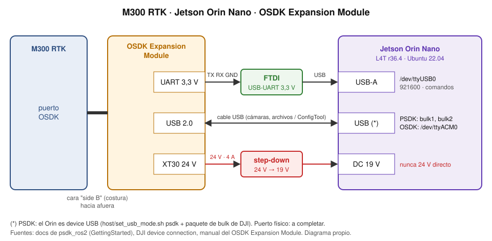

# M300 + PSDK (ROS 2 Humble): conexión y puesta en marcha

Guía para dejar un M300 RTK operando con `psdk_ros2` desde un Jetson Orin Nano. Se hace en este orden: hardware →
dron (DJI Assistant 2) → host (Jetson) → software → arranque → verificación.

Fuentes (comparadas en el § 9):
- [DJI: Jetson Nano quick guide](https://developer.dji.com/doc/payload-sdk-tutorial/en/payload-quick-start/quick-guide/jetson-nano.html):
  la guía oficial que se usó. Se arma con JavaScript y no se pudo leer automáticamente; lo que se cita sale de un
  resumen de búsqueda y del foro de DJI.
- [Aerostack2: DJI Matrice PSDK](https://aerostack2.github.io/_03_aerial_platforms/_dji_psdk/index.html) y su repo
  [`psdk_config_files`](https://github.com/aerostack2/psdk_config_files) (Xavier/Orin NX/AGX).
- [Docs de `psdk_ros2`](https://github.com/arpoma16/psdk_ros2/tree/dev/integration/docs/documentation)
  (GettingStarted: "Hardware connection", "Udev rules"), [DJI: device connection](https://developer.dji.com/onboard-sdk/documentation/quickstart/device-connection.html),
  [DJI: puertos por aeronave](https://developer.dji.com/doc/payload-sdk-tutorial/en/quick-start/drone-port.html),
  [foro de NVIDIA: USB bulk de PSDK en Jetson](https://forums.developer.nvidia.com/t/dji-psdk-usb-bulk-configuration/296552).

Lo marcado **⚠ A COMPLETAR** o **⚠ A CONFIRMAR** falta relevarlo en el dron.

## 1. Materiales

| Pieza | Nota |
|---|---|
| M300 RTK | Puerto **OSDK** (la PSDK del M300 también entra por ahí) |
| Jetson Orin Nano | L4T r36.4 (Ubuntu 22.04) |
| **OSDK Expansion Module** | Opción validada por `psdk_ros2` para el M300 (link `use_uart_and_usb_bulk_device`) |
| *o* **E-Port Development Kit** | DJI lo lista para el puerto OSDK del M300; `psdk_ros2` no lo validó en el M300. ⚠ A COMPLETAR: conexión y `link_config` con este kit |
| Adaptador USB-UART (FTDI) | **3,3 V**: el serial del M300 y del módulo es de 3,3 V (DJI) |
| Cable USB A-A | Del USB del módulo al Jetson |
| Step-down **24 V → 19 V** | El módulo entrega 24 V y el Orin Nano se alimenta a 19 V. ⚠ A COMPLETAR: modelo |

## 2. Conexión



Fotos de referencia (Aerostack2, licencia MIT; con E-Port Development Kit y Jetson AGX/NX, no Orin Nano):
[E-Port en modo *device*, el que usa el M300](https://aerostack2.github.io/_images/device_mode.jpg) ·
[conexiones USB en un AGX](https://aerostack2.github.io/_images/agx_connections.jpg) ·
[conexiones USB en un NX](https://aerostack2.github.io/_images/nx_connections.jpg).

```
M300 (puerto OSDK) ══ OSDK Expansion Module
                        ├─ UART (TX, RX, GND · 3,3 V) ── FTDI ──USB──► Jetson  → /dev/ttyUSB0   comandos y telemetría
                        ├─ USB 2.0 ──────────── cable USB A-A ───────► Jetson  → /dev/usb-ffs/bulk1, bulk2
                        │                                                        cámaras y archivos (USB bulk)
                        └─ XT30 · 24 V ── step-down 24→19 V ───────► alimentación del Jetson (19 V)
```

1. Montar el módulo en el puerto OSDK: **la cara del cable con la costura ("side B") hacia afuera** (DJI).
2. FTDI a los pines UART del módulo (el RX del módulo recibe lo que transmite el dron) y al USB del Jetson.
3. USB del módulo al Jetson. ⚠ A CONFIRMAR: **rol y puerto** (ver § 4, paso 4.g). Aerostack2 (M300 + E-Port) usa
   el Jetson como **host** por el puerto Type-C que soporta bulk. En el foro de NVIDIA, un Orin Nano funcionó con el
   E-Port directo a un **USB-A**. `host/set_usb_mode.sh psdk` configura el Jetson como **device** (gadget con
   `/dev/usb-ffs/bulk1,2`).
4. Alimentación: XT30 del módulo (24 V, 4 A nominales) → step-down **24 V → 19 V** → Jetson. Nunca los 24 V
   directo al Orin.

> **Cuidado (docs de `psdk_ros2`)**: el OSDK Expansion Module saca **24 V**. Verificá que la computadora lo tolere o
> poné un step-down. Si armás un cable propio, DJI pide usar los **4 pines VCC** a la vez.

## 3. Configuración del dron (una vez)

1. Crear una app **Payload SDK** en <https://developer.dji.com/user/apps/>. De ahí salen `app_id`, `app_key`,
   `app_license` y la cuenta de desarrollador.
2. **DJI Assistant 2** (Enterprise) con el M300 conectado: configurar el **baudrate del puerto OSDK** (921600, el de
   `cfg/psdk_params.yaml`). Si no coinciden, prevalece el de Assistant 2 (docs de `psdk_ros2`).

## 4. Host: el Jetson (una vez)

1. Docker con el runtime de NVIDIA (`container_run.sh` usa `--runtime nvidia`) y este repo clonado en
   `~/multiUAV_system` (ahí lo buscan los tmuxinator; si no, `sys=<ruta>`).
2. Red: `sudo cp devices/m300/host/netplan.yaml.example /etc/netplan/50-cloud-init.yaml`, completar las contraseñas
   WiFi y `sudo netplan apply`. Deja `eth0` en `10.20.0.51/24` y `usb0` en `192.168.42.3/24`.
3. Hora desde el GCS al arrancar (el Jetson no tiene RTC con batería): `sudo devices/common/boot/install.sh` y poner
   `GCS_HOST` en `/etc/muav/boot.env` (ver `devices/common/README.md`).
4. **Modo USB PSDK (USB bulk).** La primera vez. Junta la guía de DJI y la de Aerostack2; los pasos c y d son las
   trampas del Orin.

   a. **Paquete de DJI** (script `psdk-usb-configure.sh` + binario `startup_bulk`), en la ruta que busca
      `set_usb_mode.sh`:
      ```bash
      cd ~ && wget https://terra-1-g.djicdn.com/71a7d383e71a4fb8887a310eb746b47f/psdk/e-port/usb-bulk-configuration-reference.zip \
        && unzip usb-bulk-configuration-reference.zip -d startup_bulk \
        && mv startup_bulk/ ~/Desktop/ && chmod +x ~/Desktop/startup_bulk/*
      ```
   b. **Módulos del kernel al arrancar** (Aerostack2):
      ```bash
      echo -e "configfs\nlibcomposite\nusb_f_fs\ntegra-xudc" | sudo tee -a /etc/modules   # revisar que quede bien
      ```
   c. **Nombre del controlador USB (UDC).** Los scripts de DJI y de Aerostack2 buscan `700d0000.xudc` (T210) o
      `3550000.xudc`; si no lo encuentran, no configuran nada y `/dev/usb-ffs/bulk*` nunca aparece. Un Orin Nano con
      JetPack 6 tenía **`3550000.usb`** (foro de NVIDIA). Mirá el tuyo y, si difiere, cambialo en el script
      (Aerostack2 hace lo mismo para el AGX: `sed -i 's/3550000\.xudc/3550000.usb/g' <script>`):
      ```bash
      ls /sys/class/udc/
      ```
   d. **Ruta de `startup_bulk` dentro del script.** El script la tiene escrita (el de Aerostack2 dice
      `/home/cvar/Desktop/startup_bulk/startup_bulk`): poné la de este Jetson (`/home/<usuario>/Desktop/startup_bulk/startup_bulk`).
   e. **Los dos scripts que alterna `host/set_usb_mode.sh`.** Con el servicio de L4T apagado mientras se cambian
      (Aerostack2):
      ```bash
      sudo systemctl disable nv-l4t-usb-device-mode.service
      # backup del script original de L4T (= modo OSDK)
      sudo cp /opt/nvidia/l4t-usb-device-mode/nv-l4t-usb-device-mode-start.sh \
              /opt/nvidia/l4t-usb-device-mode/nv-l4t-usb-device-mode-start-osdk.sh
      # script de bulk (= modo PSDK), ya corregido en c y d
      sudo cp ~/Desktop/startup_bulk/psdk-usb-configure.sh \
              /opt/nvidia/l4t-usb-device-mode/nv-l4t-usb-device-mode-start-psdk.sh
      sudo systemctl enable /opt/nvidia/l4t-usb-device-mode/nv-l4t-usb-device-mode.service
      sudo reboot
      ```
      Alternativa: el `nv-l4t-usb-device-mode-start.sh` de [`psdk_config_files`](https://github.com/aerostack2/psdk_config_files)
      (para Xavier/Orin NX/AGX, con bulk + red). Igual hay que revisarle c y d.
   f. **Cambiar de perfil y verificar**, cada vez:
      ```bash
      sudo devices/m300/host/set_usb_mode.sh psdk --now    # o sin --now: aplica en el próximo arranque
      sudo devices/m300/host/set_usb_mode.sh status        # modo, servicio L4T, startup_bulk, endpoints montados
      ```
   g. ⚠ A CONFIRMAR, **rol USB en cada arranque**. Aerostack2, para el M300, pone el Jetson como **host**
      (`echo host | sudo tee /sys/class/usb_role/usb2-0-role-switch/role`), y al encender el dron debe aparecer
      `/dev/ttyACM0`. El HAL de USB bulk del Payload-SDK soporta los dos roles: host con libusb y el VID/PID de
      `link_config.json`, o device con `/dev/usb-ffs/bulkN`. El que usa el M300 lo decide la librería cerrada de DJI.
      Probar en el dron, y anotar acá el rol, el puerto físico y si existe `ls /sys/class/usb_role/` en el Orin Nano.
5. Opcional: reglas udev para nombres fijos (`/dev/dji_serial`…). Plantilla en las docs de `psdk_ros2` (sección "Udev
   rules"). ⚠ A COMPLETAR: VID/PID del FTDI que se usa.

## 5. Software (una vez, y tras cambiar un `.repos`)

```bash
cd ~/multiUAV_system/devices/m300/cfg
cp psdk_params.yaml.example psdk_params.yaml    # app_id, app_key, app_license, developer_account; módulos y frecuencias
cp link_config.json.example link_config.json    # puertos UART y endpoints USB bulk (los del ejemplo son los del módulo)
git status                                      # NO deben aparecer: están gitignored
cd ~/multiUAV_system
devices/m300/container_build.sh                 # todo: opencv → ros2 → psdk → ros1 → osdk (horas)
devices/m300/container_build.sh psdk            # solo rehacer el workspace PSDK
```

- `psdk_wrapper` lee las credenciales de **sus parámetros ROS** (`psdk_params.yaml`), no de variables de entorno.
- Credenciales viejas en formato anterior: `cfg/legacy/`. Pasalas a mano a `psdk_params.yaml` y `link_config.json`.

## 6. Arranque

```bash
tmuxinator start -p devices/m300/psdk/tmuxinator.yml ns=uav_16      # -h: parámetros
```

| Panel | Qué hace |
|---|---|
| `psdk` | Crea el contenedor y lanza `psdk_wrapper` con `cfg/psdk_params.yaml` y `cfg/link_config.json` |
| `streaming` | A los 30 s activa el streaming de la cámara principal (`camera_setup_streaming`) |
| `camera` | `rtsp_bridge`: cámara → RTSP hacia el mediamtx del GCS |
| `notify` | `mission_notifier`: avisa al GCS el fin de misión (`/GCS/GCSCommand`) |
| `download` | `downloader`: sirve la descarga de archivos por fecha |
| `shell` | Terminal dentro del contenedor |

A mano: `devices/m300/container_run.sh psdk [restart] [--no-bulk]` (`--no-bulk`: solo UART, sin cámaras).

## 7. Verificación

- `container_run.sh` ya corta si falta `cfg/psdk_params.yaml` o `cfg/link_config.json`, o si no existen
  `/dev/usb-ffs/bulk1,2`. También avisa si no ve `ttyUSB0`/`ttyACM0` o si `startup_bulk` no corre.
- Dentro del contenedor: `ros2 topic list | grep uav_16` muestra la telemetría de `psdk_ros2`.
- En el GCS: `images/build.sh humble` y `./container_run.sh bridge humble`, con el **mismo `ROS_DOMAIN_ID`** y en la
  misma red. La interfaz `dji_M300_PSDK` recibe telemetría (`psdk_interfaces/msg/*`).

## 8. Problemas comunes

| Síntoma | Causa probable |
|---|---|
| `/dev/usb-ffs/bulkN no existe` | El Jetson está en modo OSDK: `sudo devices/m300/host/set_usb_mode.sh psdk --now` |
| Sigue sin existir tras `set_usb_mode psdk` | El script no encontró el UDC (`ls /sys/class/udc/`: `3550000.usb` en vez de `xudc`, § 4.c) |
| `startup_bulk` no corre (`status`) | Ruta escrita mal dentro del script (§ 4.d), o el binario sin `chmod +x` |
| No aparece `/dev/ttyACM0` | Cableado o rol USB, no el bulk (respuesta de DJI en su foro): revisar § 4.g |
| Telemetría sí, cámara no | `startup_bulk` no corre, o se arrancó con `--no-bulk` |
| Solo funciona `use_only_uart` | Pasa en el foro de NVIDIA con Orin Nano: el bulk no levantó (§ 4.c–g) |
| El wrapper no inicializa | Credenciales de otra app, o baudrate distinto del de Assistant 2 |
| No aparece `/dev/ttyUSB0` | FTDI desconectado o sin alimentación |
| El GCS no ve nada | Otro `ROS_DOMAIN_ID`, otra red, o el GCS usa `bridge:noetic` en vez de `bridge:humble` |

## 9. Comparación de guías: qué aporta cada una

| Tema | DJI (Jetson Nano) | Aerostack2 (Xavier/Orin NX/AGX) | Esta guía |
|---|---|---|---|
| Placa | Jetson Nano | Xavier, Orin NX, AGX | **Orin Nano** (ninguna de las dos la cubre exacta) |
| Kit en el M300 | E-Port Development Kit | E-Port Development Kit en modo *device* | OSDK Expansion Module (o E-Port) |
| Paquete de bulk | `usb-bulk-configuration-reference.zip` (script + `startup_bulk`) | El mismo zip + su propio script de arranque | El zip; alternativa: el script de Aerostack2 (§ 4.e) |
| Módulos del kernel | — | `configfs libcomposite usb_f_fs tegra-xudc` en `/etc/modules` | Incluido (§ 4.b) |
| Nombre del UDC | El script busca `xudc` | `sed` `xudc` ↔ `usb` según la placa | Verificarlo antes de copiar (§ 4.c) |
| Servicio L4T | Reemplazar el script de arranque | Apagarlo, reemplazar, probar a mano, volver a prenderlo | Igual que Aerostack2, más un backup para volver a OSDK (§ 4.e) |
| Rol USB en el M300 | Interruptor host/device del E-Port Kit (el resumen dice *host*; el soporte de DJI en el foro, *device*: contradictorio) | Jetson = **host**, E-Port = **device**, `usb_role` en cada arranque | ⚠ A CONFIRMAR (§ 4.g) |
| `link_select` del M300 | — | `use_uart_and_usb_bulk_device` (M350/M30: red `l4tbr0`) | Igual (`cfg/link_config.json.example`) |
| Conmutar OSDK ↔ PSDK | — | — | `host/set_usb_mode.sh` |
| Hardware, alimentación, credenciales, Assistant 2 | Parcial | No lo cubre | §§ 1–3 |
| Plataforma de alto nivel | — | `as2_platform_dji_psdk` (Aerostack2) | No se usa: el GCS habla con `psdk_wrapper` + `MUAV_psdk_offboard`; por apt arrastra un PSDK que no es el del fork (decisión 14) |
